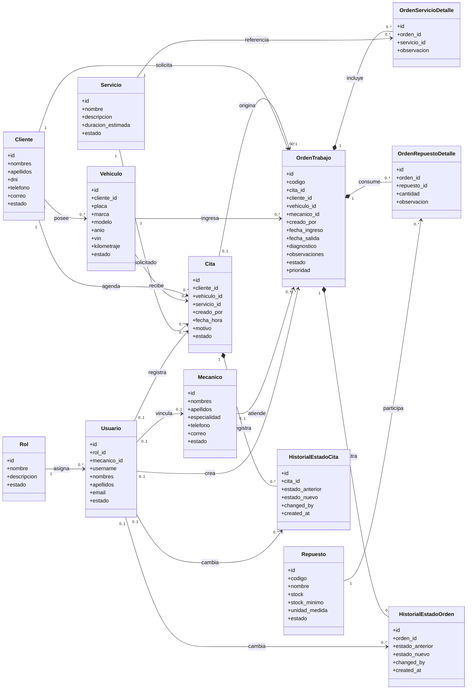

# Diagrama de Clases del Sistema

## Objetivo

Este documento presenta un diagrama de clases conceptual del sistema web del taller mecanico. El enfoque no es mostrar metodos de programacion internos, sino las entidades principales del dominio y la forma en que se relacionan mediante cardinalidades como `1:1`, `1:N` y `N:M`.

El diagrama se construyo en coherencia con el modelo definido en [schema.sql](/C:/Users/yufri/Documents/automotrices/database/schema.sql).

## Convenciones de cardinalidad

- `1`: relacion obligatoria con una sola instancia.
- `0..1`: relacion opcional con una sola instancia.
- `0..*`: relacion opcional con muchas instancias.
- Las relaciones `N:M` se resuelven mediante clases intermedias o tablas detalle.

## Diagrama UML en Mermaid

## Relaciones principales explicadas

### Relaciones 1 a muchos

- Un `Rol` puede tener muchos `Usuario`.
- Un `Cliente` puede tener muchos `Vehiculo`.
- Un `Cliente` puede registrar muchas `Cita`.
- Un `Vehiculo` puede tener muchas `Cita`.
- Un `Servicio` puede estar asociado a muchas `Cita`.
- Un `Cliente` puede tener muchas `OrdenTrabajo`.
- Un `Vehiculo` puede aparecer en muchas `OrdenTrabajo`.
- Un `Mecanico` puede atender muchas `OrdenTrabajo`.
- Una `OrdenTrabajo` puede tener muchos registros en `HistorialEstadoOrden`.
- Una `Cita` puede tener muchos registros en `HistorialEstadoCita`.

### Relaciones 1 a 1 u opcionales

- `Usuario` y `Mecanico` mantienen una relacion `0..1 : 0..1`.
- Esto significa que no todo usuario necesita estar vinculado a un mecanico.
- Tambien significa que puede existir un mecanico registrado sin acceso al sistema.
- `Cita` y `OrdenTrabajo` mantienen una relacion `0..1 : 0..1`.
- Una orden puede originarse desde una cita, pero tambien puede crearse manualmente.

### Relaciones muchos a muchos resueltas

- `OrdenTrabajo` y `Servicio` forman una relacion `N:M`, resuelta por `OrdenServicioDetalle`.
- `OrdenTrabajo` y `Repuesto` forman una relacion `N:M`, resuelta por `OrdenRepuestoDetalle`.

## Lectura academica del modelo

Este diagrama refleja una separacion correcta entre entidades operativas y entidades de acceso:

- `Usuario` representa la cuenta que inicia sesion y posee permisos.
- `Mecanico` representa al recurso humano operativo del taller.
- La vinculacion opcional entre ambas clases permite que el sistema siga siendo flexible y mas cercano a un escenario real.

Ademas, el uso de clases detalle permite modelar correctamente procesos del taller:

- una orden puede incluir varios servicios,
- una orden puede consumir varios repuestos,
- y un mismo servicio o repuesto puede repetirse en distintas ordenes sin duplicar informacion maestra.

## Uso recomendado en el informe

Este archivo puede utilizarse directamente en la parte de analisis o diseno del proyecto, especialmente en secciones como:

- modelo conceptual,
- diagrama de clases,
- relaciones entre entidades,
- reglas del negocio,
- sustento de la base de datos relacional.
